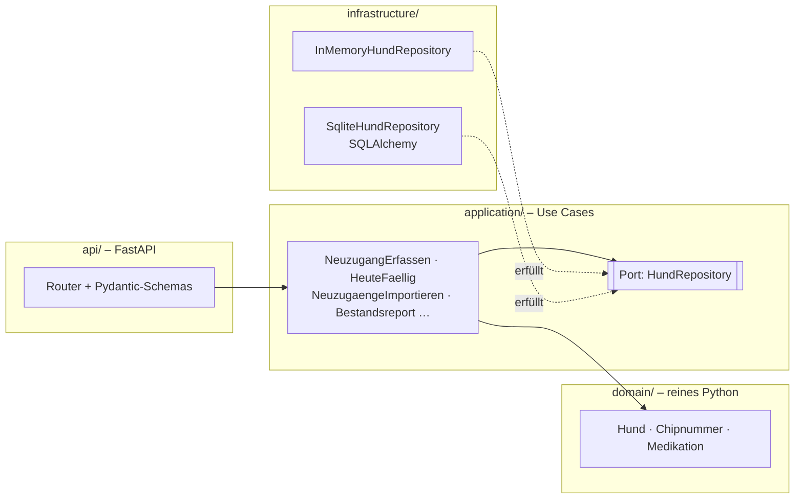

# Tierheim-Verwaltung

Backend zur Verwaltung von Tierheimhunden: Neuzugänge erfassen, Chipnummern prüfen, Medikamente
planen, Bestandsdaten aus Excel importieren und auswerten.

**Python 3.13 · FastAPI · Pydantic · SQLAlchemy 2 · SQLite · pandas · pytest · uv**

Entstanden als Lernprojekt, um Python strukturiert aufzubauen – testgetrieben (TDD) und nach
Clean Architecture. Jeder Schritt ist als kleiner, grüner Commit nachvollziehbar.

---

## Was es kann

| Bereich | Funktion |
|---|---|
| **Neuzugänge** | Hund erfassen mit Herkunft (Fundtier, Abgabe, Beschlagnahme), Aufnahmedatum, optional Rasse und Chip |
| **Chipnummer** | Prüfung nach ISO 11784/11785 (15 Ziffern, Länder-/Herstellercode), Eingabe mit Leerzeichen erlaubt, keine Duplikate im Bestand |
| **Medikation** | Medikament mit Dosis, Zeitraum und Intervall (täglich, jeden 2. Tag, wöchentlich …) |
| **Tagesliste** | Welcher Hund bekommt heute welches Medikament – nur Hunde, die noch im Heim sind |
| **CSV-Import** | Bestandsliste aus Excel (`;`, `TT.MM.JJJJ`, UTF-8 oder Windows-1252); fehlerhafte Zeilen werden mit Grund gemeldet, der Rest übernommen |
| **Report** | Belegung, Verteilung nach Status/Herkunft, durchschnittliche Verweildauer, Langzeitbewohner, Hunde ohne Chip |
| **CSV-Export** | Bestand als Excel-taugliche CSV (Rundlauf Export → Import ist getestet) |

## Schnellstart

Voraussetzung: [uv](https://docs.astral.sh/uv/) (installiert Python 3.13 bei Bedarf selbst).

```bash
cd backend
uv sync                      # Abhängigkeiten installieren
uv run pytest                # 110 Tests, ca. 2 Sekunden
uv run uvicorn tierheim.server:erzeuge_app --factory --reload
```

Dann **http://127.0.0.1:8000/docs** öffnen (interaktive API-Doku).
Zum Ausprobieren: unter `POST /import/neuzugaenge` die Datei
[`beispieldaten/bestand.csv`](beispieldaten/bestand.csv) hochladen (7 gültige, 2 absichtlich
fehlerhafte Zeilen), danach `GET /reports/bestand` aufrufen.

Die Datenbank liegt in `backend/tierheim.db` (änderbar über `TIERHEIM_DB_URL`).

## API

| Methode | Pfad | Zweck | Antworten |
|---|---|---|---|
| `POST` | `/hunde` | Neuzugang erfassen | 201 · 422 ungültig · 409 Chip vergeben |
| `GET` | `/hunde` | Bestand, neueste Aufnahmen zuerst | 200 |
| `GET` | `/hunde/{id}` | Einzelner Hund inkl. Medikationen | 200 · 404 |
| `POST` | `/hunde/{id}/medikationen` | Medikament verordnen | 201 · 422 · 404 |
| `GET` | `/medikation/heute` | Tagesliste für das Pflegepersonal | 200 |
| `POST` | `/import/neuzugaenge` | CSV-Upload | 200 mit Import-Ergebnis |
| `GET` | `/reports/bestand` | Kennzahlen für die Heimleitung | 200 |
| `GET` | `/export/bestand.csv` | Bestand als CSV-Download | 200 |

Fachliche Fehler kommen als Klartext, z. B.
`409 {"detail": "Chipnummer 276098100123456 ist bereits Luna zugeordnet.", "vorhandener_hund_id": "…"}`.

## Architektur



Abhängigkeiten zeigen nur nach innen. Daraus folgt:

- **Die Domain kennt weder HTTP noch Datenbank.** Regeln wie „Chipnummer hat 15 Ziffern“ sind ein
  unveränderliches Wertobjekt (`Chipnummer`) – ein ungültiger Chip kann gar nicht existieren.
- **Use Cases sprechen nur mit dem Port** `HundRepository` (ein `typing.Protocol`). Welche Datenbank
  dahintersteht, entscheidet allein `create_app()` bzw. `server.py`.
- **Vertragstests**: Dieselben Repository-Tests laufen gegen In-Memory und SQLite. Beim Umstieg auf
  SQLite wurden Domain, Use Cases und API nicht angefasst.
- **Fachfehler → HTTP** wird an genau einer Stelle übersetzt (`api/main.py`): `UngueltigeChipnummer` → 422,
  `ChipnummerBereitsVergeben` → 409, `HundNichtGefunden` → 404.
- **Zeit ist eine Abhängigkeit**: `heute` wird hereingereicht, damit Tests wie „Datum in der Zukunft“
  oder „Medikament heute fällig“ an jedem Tag gleich laufen.

## Projektstruktur

```
backend/
  src/tierheim/
    domain/           Hund, Chipnummer, Medikation (Regeln, keine Abhängigkeiten)
    application/      Use Cases, Port HundRepository, Import & Report (pandas)
    infrastructure/   InMemory- und SQLite-Repository
    api/              FastAPI-Router, Schemas, Fehlerübersetzung, create_app()
    server.py         Produktions-Startpunkt (SQLite, echtes Datum)
  tests/
    unit/             Domain + Use Cases, ohne I/O
    integration/      HTTP (TestClient), SQLite, Neustart-Persistenz
beispieldaten/        CSV zum Ausprobieren
docs/                 Fachlichkeit, Lernplan
CLAUDE.md             Arbeitsregeln für den KI-Coding-Agenten (TDD, Architektur)
```

## Arbeitsweise

- **TDD:** erst ein roter Test, dann minimal grün, dann aufräumen, dann Commit. Die Git-Historie zeigt
  diesen Weg Schritt für Schritt (`git log --oneline`).
- **Fachsprache im Code:** Domain-Begriffe auf Deutsch (`Neuzugang`, `Chipnummer`, `ist_faellig_am`),
  so wie sie im Tierheim verwendet werden.
- **KI-gestützt:** Entwickelt mit einem Coding-Agenten (Claude Code). Die Regeln dafür stehen in
  [`CLAUDE.md`](CLAUDE.md): Test zuerst, kleine Schritte, Abhängigkeitsregel einhalten.

## Ausblick

- Next.js-Frontend (Bestandsliste, Neuzugangsformular, Tagesliste)
- Use Case „Chip nachtragen“ mit Duplikatprüfung, Statuswechsel (vermittelbar → reserviert → vermittelt)
- Status-Spalte beim CSV-Import übernehmen
- PostgreSQL als weiteres Repository (muss nur die Vertragstests bestehen)
